+++
title = "Terminal borders that don't cost a cell"
date = "2026-11-13T12:00:00-08:00"
description = "A terminal protocol for thin lines on cell edges: borders, rounded corners and gridlines that don't use up rows or columns. Working in Ghostty, with Ratatui demos."
[taxonomies]
tags = ["Terminals", "TUI", "Ratatui", "Ghostty"]
[extra]
og_image = "og.png"
+++

_This post (and the code behind it) was written with a lot of help from AI. I'm not going to
apologize for that. If that bothers you, feel free to close the tab._

I maintain [Ratatui], so I see a lot of the TUIs people build. Many of them end up looking fairly
same-ish: plain boxes on a boring background, missing a bunch of the things that good design in
other mediums brings us.

Borders are part of the problem. They have to take up space, so they become part of the panels
people want to build. One option is to drop them and just use color, but borders are really nice
for delineating and surrounding things. There are lots of ways to sort of get borders in a
terminal, but none that are 100% good. I've drawn enough `┌──┐` by hand to have opinions about
this.

The usual way is the Unicode Box Drawing block, which has 128 characters for lines, corners and
joins. Somehow that's still not enough:

[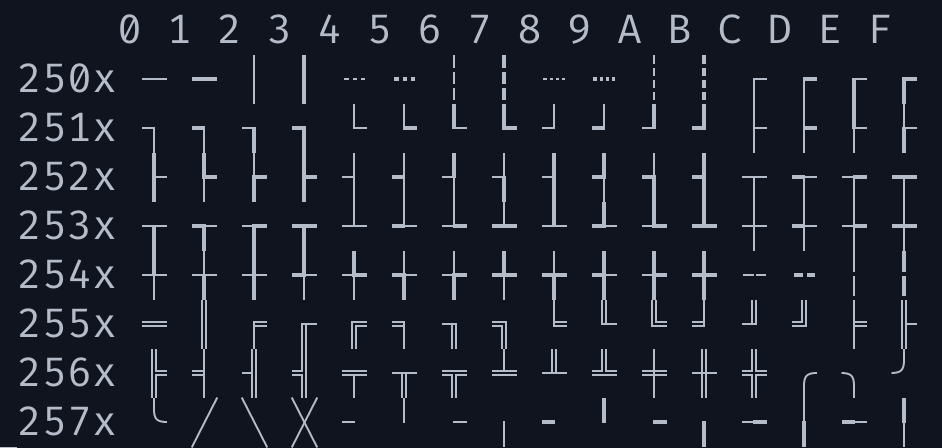](box-drawing-block.png)

So I've been working on a terminal protocol that draws thin lines on the edges of cells instead.
I've got it working as [a patch to Ghostty][branch] (and [an earlier version in
Rio][raphamorim/rio#1947] before that), and
I've built demo apps for it with Ratatui. I'd like feedback from
terminal and TUI authors.

[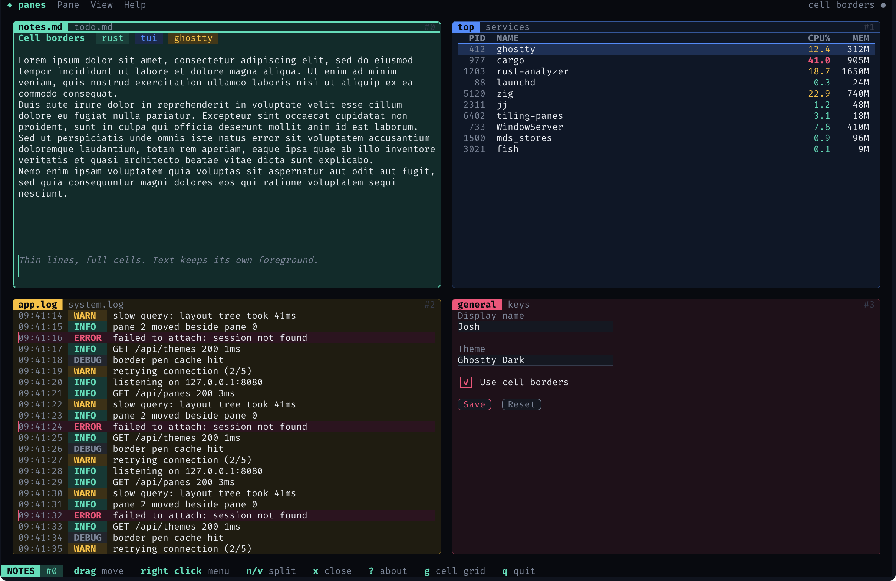](panes.png)

<!-- more -->

Every line in that screenshot is a cell border. None of them use up a row or column. The tab
labels sit on the top edge of each pane, the text fields are underlined right under the text, and
the buttons are one row tall and rounded.

Here's the same app in a terminal without cell borders, falling back to box-drawing characters:

[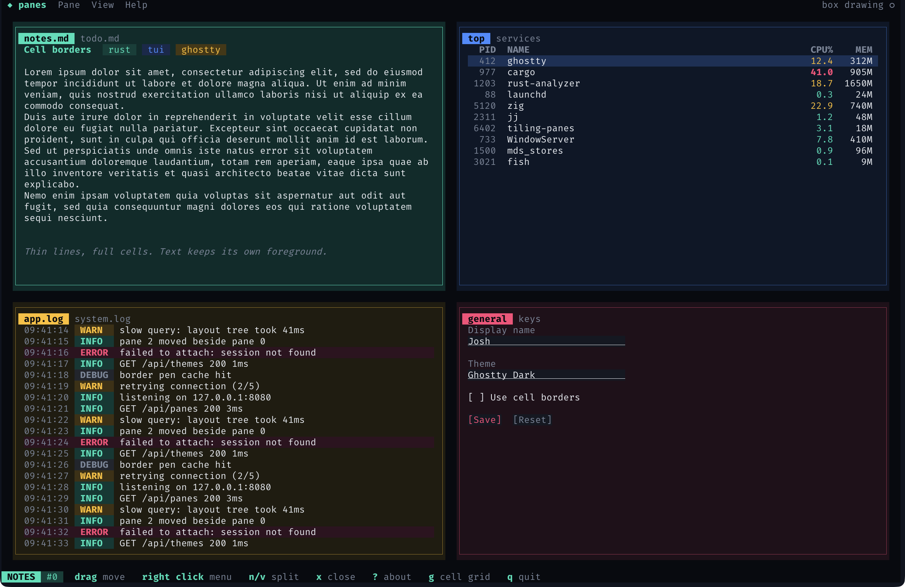](panes-box.png)

Each pane loses a row and a column on every side, so the log pane shows two fewer lines and the
notes wrap differently. The tab labels move inside the frame. The text fields use the underline
attribute instead, and the checkbox and buttons turn into brackets.

## What I'd use it for

- Borders, obviously. Panes and panels that don't eat a row and column on every side.
- Menus and popups that sit on top of other content and still look like they're on top.
- Panel style apps, where the layout is a set of regions that each want an edge.
- Widgets like text fields, buttons and checkboxes, which want a line right up against their text.
- Making things look neater in general. A border on the outer edge of a panel's background looks
  a lot cleaner, and text can run right up to it.

### Up close

The settings form, with cell borders and then with the box-drawing fallback:

[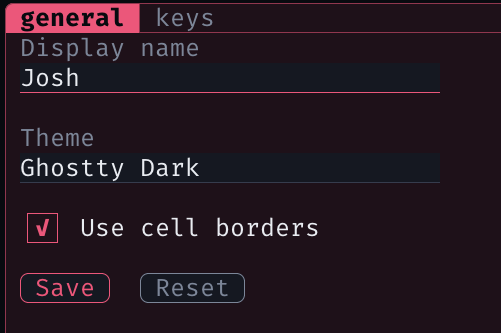](zoom-form.png)

[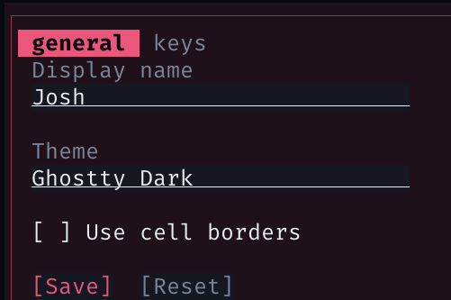](zoom-form-box.png)

The tabs are the same story. With cell borders they sit on the pane's top edge. With box
characters they need their own row inside the frame:

[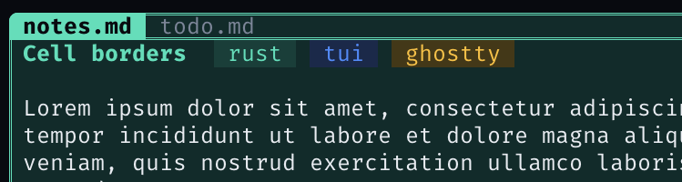](zoom-tabs.png)

[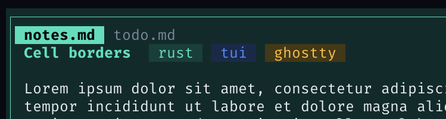](zoom-tabs-box.png)

### Charts

Lines between cells also work for charts. btop-style braille graphs fill every cell with dots, so
there's nowhere to put a gridline or an average line without giving up a row. With cell borders
they sit on the cell edges between the dots. Here's a monitor in that style, built with Ratatui:

[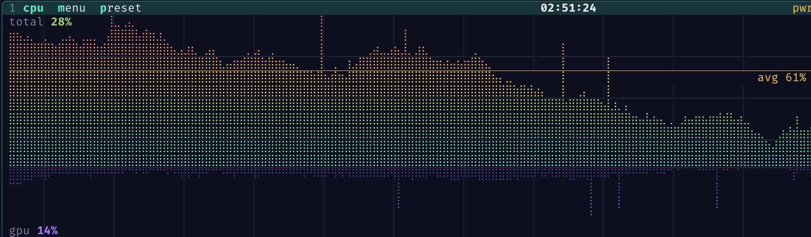](chart.png)

And the fallback, which has to drop the gridlines:

[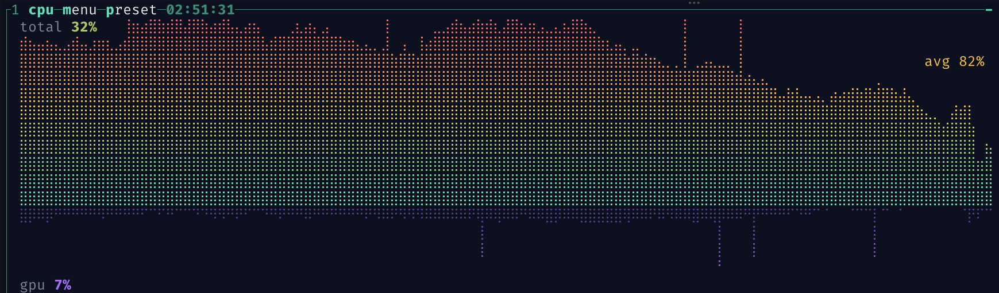](chart-box.png)

### In motion

Here's the tiling panes demo moving panes around, opening menus and the about dialog:

[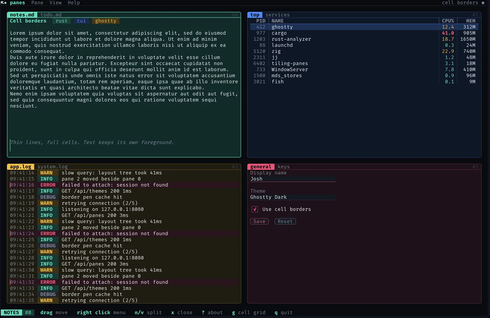](tour.webp)

Partway through, it turns on a checkerboard of the cells, which shows how everything lines up
with the grid. Toggle it here:

<style>
.grid-toggle input { margin-right: 0.4em; }
.grid-toggle .on { display: none; }
.grid-toggle input:checked ~ .on { display: block; }
.grid-toggle input:checked ~ .off { display: none; }
.grid-toggle img { max-width: 100%; }
</style>
<div class="grid-toggle">
<input type="checkbox" id="grid-toggle"><label for="grid-toggle">Show the cell grid</label>
<a class="off" href="grid-off.png">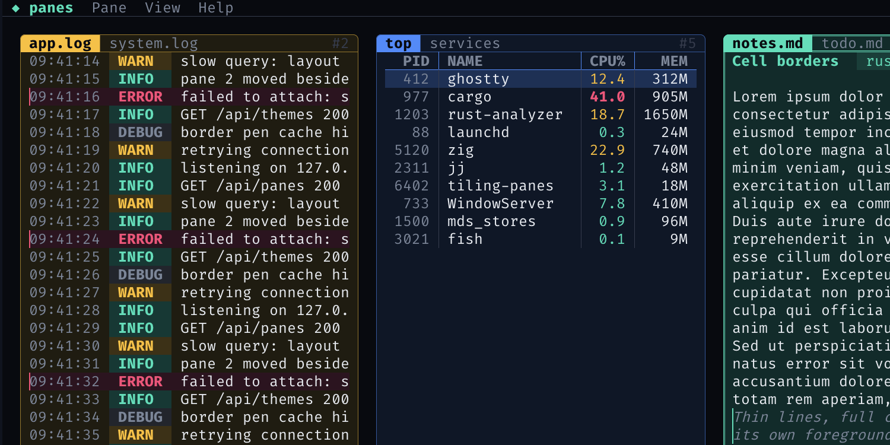</a>
<a class="on" href="grid-on.png">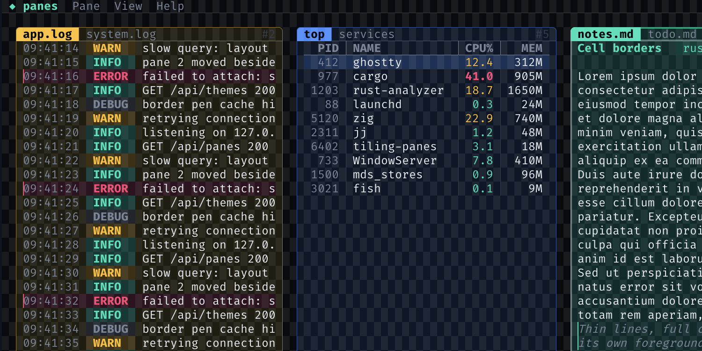</a>
</div>

## What box characters can't do

The root of it is that box-drawing characters are text. Each line is a glyph that takes up a whole
cell, and pretty much everything annoying about them falls out of that.

Space is the obvious one. On my 16" laptop with a font I can actually read, the terminal is
something like 200x50 (your prefs will move that around a bit). Columns are mostly fine at that
size. Rows aren't. A layout with a couple of levels of nested panels can easily spend 6 or 8 of
those 50 rows on nothing but lines. That's a lot of screen to give up for decoration.

You also can't put a line between two cells that both have something in them. So there's no way to
underline a text field right under its text, or to outline a button, without adding padding around
it. Rounded corners sort of work, except the corner glyph has one background color, and when the
panel's background is different from what's around it you get a little square of the wrong color
in each corner. And the line itself is whatever the font decides it is, weight and position
included.

Then there's copy and paste. Select some text inside a box and you get the box too. Everyone who's
pasted from a TUI into Slack knows the little `│` cleanup dance. Sometimes you do want the box
(pasting a table into a chat, say), but mostly it's junk. Cell borders aren't text, so they never
get copied, which cuts both ways.

## How it works

A cell border is a cell attribute, like a background color. Each cell can carry up to twelve line
segments: the two halves of each of its four edges, and four arms from its center. Each segment
has its own color, width, placement and style, and the terminal draws them over the cell grid.
Borders are stored in the cells, so they scroll, erase, insert and reflow with the text. What
happens on erase or scroll already has an answer, the same one as for colors.

The edges are split into halves so borders line up with quadrant block characters (`▖▗▘▝` and
friends). That makes it easy to draw a shape that's a half cell in from the grid and still put a
neat border around it. Yes, that still uses a character for the fill, and there might be a better
way to do that part. One problem at a time.

The same idea could stretch to sextants and octants, or to quarter and eighth widths, if designs
need them.

### Styles and joints

[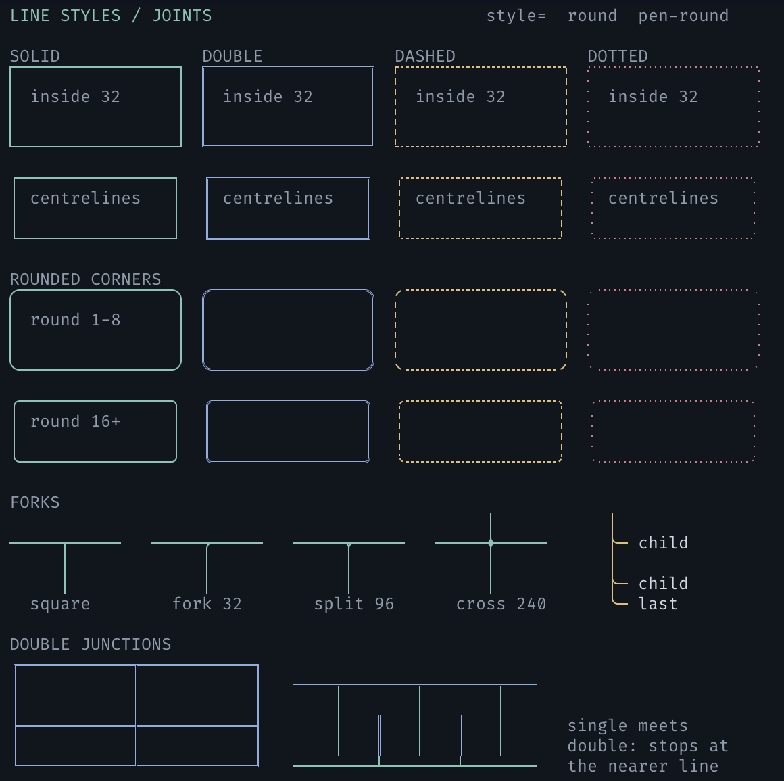](styles.png)

[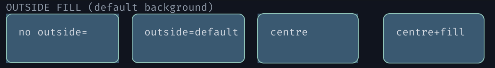](zoom-outside.png)

Lines can be solid, double, dashed or dotted. Each corner and center of a cell can be square or
rounded, with a configurable radius and anti-aliased arcs. A rounded corner can name an outside
color, so the area outside the arc is painted correctly when the panel's background differs from
what's behind it.

When two neighboring cells both put a line on their shared edge, they merge into one line. The
stroke with the higher `priority` wins, then the wider one, then the one to the right or below.
That way a focused pane can raise its priority and keep its whole outline, whatever order its
neighbors were drawn in. My first try was "right/bottom always wins", which lasted until the
focused pane lost half its outline to its neighbor.

## The wire format

Everything is one DCS string with a namespace:

```text
ESC P 1 + b cell-border ; OP ; FIELDS... ESC \
```

The common path is a pen, held in the cursor like the current background color. Set it, print
some text, and the printed cells get the borders:

```text
ESC P 1 + b cell-border;pen;48;32;7aa2f7;0;0 ESC \     bottom edge, blue: an underline
hello
ESC [ 0 m                                              SGR 0 clears the pen
```

There are also rectangle commands that set or clear borders on existing cells without touching
the pen, and a capability query. An app sends the query followed by DA1. If the DA1 reply arrives
without a `cell-border` reply first, the terminal doesn't support it, so the app falls back to box
characters and reserves the space they need. Terminals that don't understand the DCS ignore it,
the same as any unknown DCS.

The minimum a terminal needs is the pen, the rectangle commands and solid strokes. I've tried to
keep that first cut small, because there's always one more "... and this" to add, and that's a
slippery slope.

Line styles, rounded joints, priority and outside colors are extension fields listed in the
capability reply, and unknown fields are ignored, so they can be added later. I'd rather the
early decisions be two way doors where possible.

The spec calls itself version 1 (it's the `1` in `DCS 1 + b`). That's v1 in the old sense, before
we all got bogged down in semver. It doesn't mean done or stable, it means it's the first one I was willing to write
down. Read it as v0.1, or a draft, or whatever you prefer.

## Prior art

Parts of this have been done before:

- **DEC ruled lines** in DECterm (extension 43 in the DA1 reply) draw lines around rectangles.
  They scroll with the text, but they're a separate layer: clearing the screen leaves them behind,
  and they're always one pixel wide in the normal text color.
- **SGR 51 to 65**: framed, encircled, overline and the ideogram side lines. Some terminals draw
  borders with them, but they're on/off attributes with no color, width or joins, and there's no
  attribute for the bottom edge.
- The **Win32 console** has per-cell grid flags for the top, left and right edges. **PDCurses**
  and **X/Open curses** (`WA_TOP`, `WA_LEFT` and friends) have similar attributes. These are the
  closest to this protocol, but they have no bottom edge (Win32), color, width or halves.
- **IBM 3270** terminals can outline whole input fields.

What none of these give you is a line with its own color and width on each edge. The
[rationale document][rationale] covers the prior art in more detail and explains each choice in
the protocol.

My own first prototype was in Rio ([raphamorim/rio#1947]), with an earlier
version of the spec that used APC instead of DCS. Feedback pointed out that APC isn't safe to
reuse: Kermit 95 has run APC payloads as Kermit commands since the 90s. DCS is where structured
terminal commands already live, and terminals ignore DCS strings they don't recognize, so I
switched to that.

## The awkward (edge) cases

When I first showed this around, most of the questions were about these. The spec goes into all
of them properly, but here's roughly where I landed.

Multiplexers were the first thing people asked about. tmux and friends redraw panes from their own
idea of the cell grid, so passing these sequences through would just put borders in the wrong
place. A multiplexer that doesn't know about the protocol should drop them and answer DA1 itself,
and then apps running inside it fall back to box characters like they would anywhere else. One
that does know about it can store borders like any other attribute and redraw them.

Conflicting lines on a shared edge are settled when the terminal renders, using the priority rule
above, so it doesn't matter what order the app wrote the cells in.

Erase, insert and delete all work the way they do for background colors. Erased cells pick up the
current pen, and lines that get inserted or deleted take their borders along. Scrollback, the
alternate screen and reflow mostly come for free, because the border lives in the cell.

On cost: the Ghostty change is about 1,650 lines, and a fair chunk of that is tests. Each cell gets
a 16-bit border ID, which fits in padding that was already there, so cells don't get any bigger
and a screen with no borders costs nothing extra. The IDs point into a table of distinct border
sets (about 100 bytes each) that's shared by the whole terminal. A typical TUI only uses a
handful of distinct sets, but the table is never freed, so in the worst case (all 65,535 IDs in
use) it's somewhere around 10-15 MB.

Rendering only does extra work for cells that have borders. Each one looks at its four neighbors to
resolve shared edges, so changing a row also rebuilds the rows either side of it. Straight lines
are a few solid quads per cell. Rounded corners cost more, because the anti-aliased arc is drawn as
rows of small quads, roughly one per edge pixel. I haven't benchmarked any of this properly yet,
and it's the part I'd most like another set of eyes on.

## Try it

The [spec][spec] and [rationale][rationale] are on my Ghostty fork. The [Ghostty
branch][branch] implements all of version 1. I've only built and run it on macOS so far, so the
GTK and OpenGL builds are untested. To build and run it (you'll need Zig 0.17 and Xcode):

```shell
git clone -b joshka/cell-borders https://github.com/joshka/ghostty.git
cd ghostty
zig build -Doptimize=ReleaseFast -Dxcframework-target=native
open zig-out/Ghostty.app
```

Inside that Ghostty, the gallery script on the same branch draws the style gallery above. It
detects support first, so it's also a quick check for another terminal's implementation:

```shell
python3 scripts/cell-borders.py            # the default view
python3 scripts/cell-borders.py --styles   # line styles, joints and outside fill
```

Once it's running you can flip between views with keys: `p` placement, `c` colors, `h` blocks, `j`
junctions, `e` halves, `s` styles and `l` live. `w` cycles the stroke width, `b` turns borders off
so you can compare, and `q` quits. Each view also has a matching flag (`--placement`, `--styles`
and so on) if you want to start on it.

The tiling panes demo is on the [Ratatui branch][ratatui-branch]. It falls back to box-drawing
characters when the terminal doesn't support cell borders, which is how I made the comparison
shots above:

```shell
git clone -b joshka/cell-borders https://github.com/joshka/ratatui.git
cd ratatui
cargo run -p tiling-panes
```

Drag panes around with the mouse to retile them. `n` and `v` split, `x` closes, and right click
opens a pane menu. Press `b` to switch between cell borders and box drawing, or `g` to shade
alternate cells and see where the edges are.

The btop-style monitor from the chart screenshots is in the same branch. Given how much of it an AI
wrote, I did briefly consider calling it bslop:

[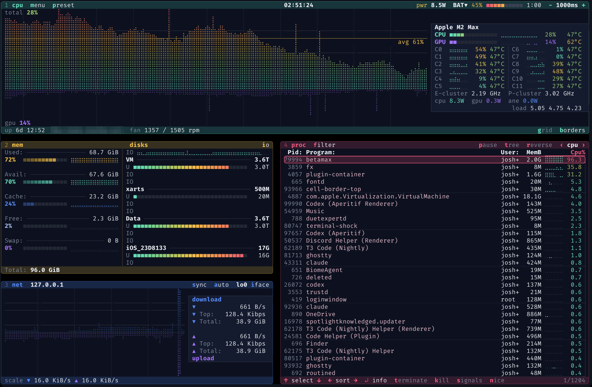](bslop.png)

To run it:

```shell
cargo run -p cell-border-top
```

It's a real system monitor (it reads your actual CPU, memory, network and processes), so it's a
better test of how this looks on a busy screen than the panes demo. `1` to `4` show and hide the
boxes, `b` and `g` work the same as in the panes demo, and `h` or `?` lists the rest of the keys.
It needs a newer Rust (1.95) than the rest of Ratatui because of the `sysinfo` dependency.

## What I'd like to hear

I'm not attached to this being the exact solution, but I think it's a problem worth solving, and
I'd like it to be more than one terminal's feature (and more than one weekend's worth of yak
shaving). If you work on a terminal, would you implement this, and which parts look expensive? If you work on a TUI library or app, which of your widgets
would use it, and what would they need that isn't here? Comments are welcome on the
[Ghostty discussion][discussion].

[Ratatui]: https://ratatui.rs
[spec]: https://github.com/joshka/ghostty/blob/joshka/cell-borders/specs/cell-border-protocol.md
[rationale]: https://github.com/joshka/ghostty/blob/joshka/cell-borders/specs/cell-border-rationale.md
[branch]: https://github.com/joshka/ghostty/tree/joshka/cell-borders
[ratatui-branch]: https://github.com/joshka/ratatui/tree/joshka/cell-borders
[discussion]: https://github.com/ghostty-org/ghostty/discussions/14324
[raphamorim/rio#1947]: https://github.com/raphamorim/rio/pull/1947
